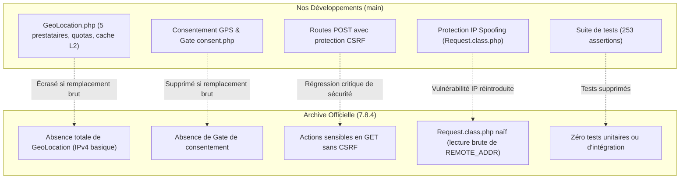

# RAPPORT COMPARATIF OFFICIEL — AUDIT GEMPIXEL 8.0.6 vs CODEBASE ACTUELLE

**Dépôt :** `https://github.com/Ajkassime/qrcode`  
**Branche de référence :** `main` (commit `718a7f4`)  
**Archive analysée :** `main.zip` / répertoire local `main 8.0.6`  
**Date de l'audit :** 13 octobre 2026  

---

## 1. IDENTIFICATION LÉGALE ET FORENSIQUE DES VERSIONS

### A. Révélation majeure : Version réelle de l'archive fournie
L'archive fournie a été transmise sous l'appellation `main 8.0.6`. L'analyse rigoureuse du code source révèle que **l'archive ne contient pas la version 8.0.6 de GemPixel Premium URL Shortener**, mais la version **7.8.4**.

#### Preuves matérielles irréfutables dans le code source de l'archive :
1. **Contrôleur d'installation (`app/controllers/SetupController.php`) :**
   ```php
   // Ligne 30
   private $version = '7.8.4';
   ```
2. **Contrôleur de mise à jour (`app/controllers/UpdateController.php`) :**
   ```php
   // Ligne 30
   private $latest = "7.8.4";
   ```
   La méthode de migration de schéma la plus récente implémentée dans l'updater est `update784()` (lignes 285-299). Aucune méthode `update80()` ou `update806()` n'existe dans le contrôleur.
3. **Espace de travail développeur (`workspace.code-workspace`) :**
   ```json
   "content" : "@author GemPixel <https://gempixel.com> \n@version 7.7"
   ```
4. **Origine de la confusion avec le libellé « 8.0.6 » :**
   L'unique occurrence de la chaîne de caractères `8.0.6` dans l'ensemble de l'archive se situe dans :
   `vendor/phpfastcache/phpfastcache/CHANGELOG.md:63: ## 8.0.6`
   Il s'agit de la version de la dépendance Composer **PHPFastCache v8.0.6** (utilisée pour le cache de fichiers), et non de la version du progiciel GemPixel Premium URL Shortener lui-même.
5. **Horodatage des fichiers :**
   Les fichiers de l'archive datent de janvier à mars 2026 (fichiers modifiés le 10 mars 2026), tandis que la version 8.0.6 officielle de GemPixel a été publiée le **10 septembre 2026** sur le changelog officiel.

### B. Version de notre application actuelle (`main` sur `Ajkassime/qrcode`)
1. **Base GemPixel d'origine :** Version **7.6.3**
   - `SetupController.php` : `private $version = '7.6.3';`
   - `UpdateController.php` : `private $latest = '7.6.3';` (dernière méthode présente : `update762()`)
   - Dump de base de données `innovstu_qr.sql` : table `settings`, enregistrement `('version','7.6.3')`.
2. **Évolution personnalisée :** Branche **7.6.3 durcie + Moteur Codex (PR #1 fusionnée)**
   - Notre application ne se limite pas à GemPixel 7.6.3 : elle intègre l'ensemble des développements majeurs de la PR #1 (géolocalisation mondiale, protection des quotas, sécurité CSRF/POST, consentement GPS, et 253 tests validés sur PHP 8.1, 8.2 et 8.3).

---

## 2. SYNTHÈSE DES VOLUMES ET DIFFÉRENCES FICHIER PAR FICHIER

L'analyse comparative exhaustive entre la branche `main` et l'archive officielle (hors `vendor`, `.git`, `tests`, logs et caches de compilation) établit les métriques suivantes :

| Métrique | Nombre de fichiers | Description |
| :--- | :---: | :--- |
| **Fichiers strictement identiques** | **1 211** | Code partagé inchangé |
| **Fichiers modifiés** | **356** | Fichiers avec modifications logiques ou structurelles |
| **Fichiers ajoutés dans l'archive officielle** | **103** | Nouvelles fonctionnalités GemPixel 7.7 à 7.8.4 |
| **Fichiers présents uniquement dans notre dépôt** | **374** | Développements Codex (GeoLocation, tests, scripts CLI, doc, thème personnalisé Rohy) |

---

## 3. ANALYSE DÉTAILLÉE DES NOUVEAUTÉS OFFICIELLES (GEMPIXEL 7.7 À 7.8.4)

Bien que l'archive ne soit pas la 8.0.6 finale, elle représente un saut fonctionnel majeur depuis la 7.6.3 (3 versions intermédiaires : 7.6.4, 7.7, 7.8 et 7.8.4).

### 1. Contrôle d'accès basé sur les rôles (RBAC) — *Priorité Haute*
- **Fichiers :** `app/controllers/admin/RolesController.php`, `app/helpers/Permissions.php`, table SQL `roles`.
- **Fonctionnalité :** Création de rôles administratifs personnalisés avec assignation granulaire des permissions (ex. `links.view`, `stats.view`, `users.edit`, `settings.view`). Le rôle `1` est automatiquement affecté en tant que *Super Administrator*.
- **Impact sur notre code :** Tous les contrôleurs d'administration officiels appellent désormais `if(!user()->hasRolePermission('...'))`.
- **Compatibilité :** Compatible avec adaptation. Nécessite l'exécution de la migration SQL de la table `roles`.

### 2. Modèles de QR Codes prédéfinis (`QrTemplates`) — *Priorité Haute*
- **Fichiers :** `app/controllers/admin/QrTemplatesController.php`, table SQL `qrtemplates`, modifications dans `app/controllers/user/QRController.php`.
- **Fonctionnalité :** Permet à l'administrateur de définir des gabarits de styles QR (couleurs, gradients, matrices, yeux, logos prédéfinis, cadres) que les utilisateurs finaux peuvent appliquer en un clic.
- **Impact sur notre code :** Notre code a centralisé l'application des designs dans `\Helpers\QR::applyDesign()`. L'intégration des templates doit réutiliser notre helper centralisé pour éviter toute régression de rendu SVG/PNG.

### 3. Modèles de paramètres de liens (`ParamTemplates`) — *Priorité Moyenne*
- **Fichiers :** `app/controllers/user/ParamTemplatesController.php`, table SQL `paramtemplates`, modifications dans `app/traits/Links.php`.
- **Fonctionnalité :** Les utilisateurs peuvent enregistrer des ensembles de paramètres de tracking (ex. balises UTM Google Analytics, Meta Pixel) et les appliquer en un clic lors de la création ou modification d'un lien court / QR code.
- **Compatibilité :** 100 % compatible sans conflit logique avec nos modules de géolocalisation.

### 4. Modèles de pages Bio (`BioTemplates`) et nouveaux thèmes — *Priorité Moyenne*
- **Fichiers :** `app/controllers/admin/BioTemplatesController.php`, table SQL `biotemplates`, thèmes Bio additionnels (`Notepad`, `Animated Gradient`, `Isometric`, `Cyberpunk`, etc.).
- **Fonctionnalité :** Bibliothèque de styles prédéfinis pour les profils et pages Bio.
- **Compatibilité :** Totalement indépendant de notre moteur de scan QR et de redirection.

### 5. Intégration de la solution CAPTCHA Altcha — *Priorité Haute*
- **Fichiers :** `app/helpers/Captcha.php`, `composer.json` (`"altcha-org/altcha": "^1.1"`), route `/captcha/challenge`.
- **Fonctionnalité :** Alternative moderne et conforme RGPD à reCAPTCHA et Cloudflare Turnstile, basée sur une preuve de travail cryptographique côté client sans cookies ni traceurs.
- **Compatibilité :** Recommandé. Nécessite l'installation du package Composer `altcha-org/altcha`.

### 6. Authentification à deux facteurs par e-mail (`Email 2FA`) — *Priorité Moyenne*
- **Fichiers :** `app/controllers/Auth/TwoFactorController.php`, table SQL `email2fa`.
- **Fonctionnalité :** Envoi d'un code OTP à 6 chiffres par e-mail en complément de Google Authenticator.

### 7. Règles de ciblage combiné avancé (`Advanced Targeting`) — *Priorité Haute*
- **Fichiers :** `app/traits/Links.php`, `app/controllers/LinkController.php`.
- **Fonctionnalité :** Permet de définir une redirection spécifique lorsque **trois critères sont réunis simultanément** (Pays ET Appareil ET Langue).
- **Conflit potentiel avec Codex :** Dans `LinkController.php`, le ciblage avancé officiel évalue `$geo = $request->country();` de manière basique. Il devra être branché sur notre moteur `GeoLocation` pour bénéficier de la précision IP MaxMind et du consentement GPS.

---

## 4. CONFRONTATION DES ANNONCES GEMPIXEL 8.0.6 AVEC L'ARCHIVE FOURNIE

| Fonctionnalité annoncée pour 8.0.6 (Site officiel) | Présence réelle dans l'archive fournie | Statut & Diagnostic |
| :--- | :---: | :--- |
| **Support de cache Redis natif** | **ABSENT** | L'archive utilise PHPFastCache Files. Aucun driver Redis configuré dans `config.php` ou `core/`. |
| **In-App Browser Breakout (Instagram, Facebook, TikTok)** | **ABSENT** | La fonctionnalité de rupture de WebView n'est pas présente dans le contrôleur de redirection de l'archive. |
| **Assistant IA (AI Copilot OpenAI / Claude)** | **ABSENT** | Aucun code ni contrôleur lié à un copilot IA dans l'archive. |
| **Gestion des plugins installés** | **ABSENT** | Le gestionnaire de plugins reste celui de la version 7.6. |
| **Rôles et permissions RBAC** | **PRÉSENT** | Introduit en 7.7, pleinement fonctionnel dans l'archive. |
| **Modèles de QR codes (QrTemplates)** | **PRÉSENT** | Introduit en 7.6.4, pleinement fonctionnel dans l'archive. |
| **Modèles UTM (ParamTemplates)** | **PRÉSENT** | Introduit en 7.8.4, pleinement fonctionnel dans l'archive. |
| **Protection Altcha (PoW Captcha)** | **PRÉSENT** | Introduit en 7.8, pleinement fonctionnel dans l'archive. |
| **Authentification Email 2FA** | **PRÉSENT** | Introduit en 7.8, pleinement fonctionnel dans l'archive. |

---

## 5. ZONES DE CONFLIT MAJEURES AVEC LES DÉVELOPPEMENTS CODEX

Le tableau ci-dessous recense les points où le code officiel de l'archive écraserait nos fonctionnalités si une copie aveugle était effectuée :



### Détail des conflits critiques :
1. **`core/Request.class.php` :**
   - *Codex :* Validation des plages CIDR Cloudflare, parcours sécurisé de `X-Forwarded-For` avec `TRUSTED_PROXY_IPS`, détection stricte des extensions et types MIME dangereux sur les uploads.
   - *Officiel :* Version naïve lisant directement les en-têtes sans filtrage de mandataire.
   - *Décision :* Conserver notre version Codex enrichie de `Request.class.php`.
2. **`app/traits/Links.php` :**
   - *Codex :* Enregistrement en base des colonnes étendues (`region`, `geo_source`, `accuracy_radius`), calcul du hash IP d'anonymisation, session scan-bound.
   - *Officiel :* Enregistrement standard pays/ville, mais ajout du ciblage combiné `advancedRules`, des modèles `paramtemplates`, et du hook `link.update.stats.limitedreached`.
   - *Décision :* Fusionner chirurgicalement : greffer les ajouts officiels (`advancedRules`, `paramtemplates`) dans notre méthode `updateStats` protégée.
3. **`app/controllers/LinkController.php` :**
   - *Codex :* Contrôleur avec endpoint `geoConsent()`, gate de consentement GPS, préservation de la redirection WhatsApp.
   - *Officiel :* Absence de `geoConsent()`, mais gestion des images d'avatars de profils Bio et ciblage avancé.
   - *Décision :* Conserver l'intégralité du cycle de vie de consentement et y insérer les nouveaux cas de redirection de profil.
4. **`app/routes.php` :**
   - *Codex :* 7 routes d'action sensibles converties en `POST` avec middleware `CSRF`.
   - *Officiel :* Ces routes sont toujours déclarées en `GET` sans protection CSRF, mais de nouvelles routes (`/captcha/challenge`, `roles`, `qrtemplates`, `paramtemplates`) sont ajoutées.
   - *Décision :* Conserver impérativement la protection POST + CSRF sur nos routes et ajouter uniquement les nouvelles définitions de routes officielles.
